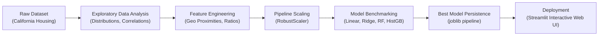

# 🏡 California House Price Prediction (End-to-End Data Science Project)

A complete, production-grade Data Science and Machine Learning project for predicting residential real estate values in California. Includes exploratory data analysis, domain-specific feature engineering, multi-model benchmarking, automated pipeline persistence, and an interactive Streamlit web dashboard.

---

## 📌 Project Architecture & Workflow



---

## 📊 Dataset Overview

- **Source:** California Housing Dataset (`scikit-learn` / US Census Bureau).
- **Instances:** 20,640 block groups.
- **Target:** `MedHouseVal` (Median house value, normalized in units of $100,000).
- **Key Features:**
  - `MedInc`: Median income in block group ($10,000s)
  - `HouseAge`: Median house age (years)
  - `AveRooms`: Average number of rooms per household
  - `AveBedrms`: Average number of bedrooms per household
  - `Population`: Block group population
  - `AveOccup`: Average number of household members
  - `Latitude` & `Longitude`: Geographic coordinates

---

## 🛠️ Feature Engineering

Custom transformer `HousingFeatureAdder` computes high-signal real estate indicators:
1. **Bedrooms-to-Room Ratio (`BedroomsPerRoom`)**: Indicator of house layout luxury/efficiency.
2. **Rooms per Person (`RoomsPerPerson`)**: Density & living space index.
3. **Geographic Proximity Proxies (`DistToLA`, `DistToSF`, `MinDistToHub`)**: Euclidean distance to California's primary economic and tech hubs.

---

## 📈 Model Benchmark Results

Models evaluated on an 80/20 train/test split:

| Model | $R^2$ Score | RMSE ($ USD) | MAE ($ USD) | Notes |
| :--- | :---: | :---: | :---: | :--- |
| **Linear Regression (Baseline)** | 0.6622 | $66,533.29 | $47,920.15 | Fast baseline |
| **Ridge Regression** | 0.6622 | $66,533.48 | $47,916.97 | Regularized linear model |
| **Random Forest Regressor** | 0.8277 | $47,522.29 | $30,507.34 | Non-linear ensemble |
| **Hist Gradient Boosting** 🏆 | **0.8503** | **$44,293.43** | **$28,873.27** | **Best overall performance** |

---

## 📁 Repository Structure

```
house-price-prediction/
├── README.md                           # Comprehensive documentation
├── requirements.txt                    # Project dependencies
├── eda.py                              # Exploratory data analysis & plots
├── predict.py                          # CLI inference script
├── app.py                              # Interactive Streamlit Web App
├── plots/                              # Generated EDA charts
│   ├── correlation_heatmap.png
│   └── target_distribution.png
├── models/                             # Serialized artifacts
│   ├── house_price_pipeline.joblib     # Production Scikit-Learn pipeline
│   └── model_metadata.json             # Benchmarks & feature metadata
└── src/
    ├── __init__.py
    ├── data_loader.py                  # Dataset fetching and splitting
    ├── feature_engineering.py          # Custom scikit-learn transformers
    ├── evaluate.py                     # Evaluation metrics (RMSE, MAE, R²)
    └── train.py                        # Training & benchmarking pipeline
```

---

## 🚀 Getting Started

### 1. Install Dependencies
```bash
pip install -r requirements.txt
```

### 2. Run Exploratory Data Analysis (EDA)
Generates summary statistics and saves visual charts into `plots/`:
```bash
python eda.py
```

### 3. Train & Benchmark Models
Trains candidate regressors, selects the top performer, and exports the serialized pipeline:
```bash
python src/train.py
```

### 4. Run CLI Prediction
Test inference on arbitrary property inputs:
```bash
python predict.py
```

### 5. Launch the Interactive Web Application
Start the Streamlit dashboard in your browser:
```bash
streamlit run app.py
```

---

## 💡 Key Takeaways for Interviews & Portfolios
- **Why HistGradientBoosting over Random Forest?** HistGradientBoosting bins continuous features into integer bins (histogram-based), achieving faster training times, lower memory consumption, and superior $R^2$ performance on continuous tabular data.
- **Handling Multi-Collinearity & Spatial Geometry:** Linear models struggled with spatial coordinates ($R^2 \approx 0.66$); non-linear tree ensembles effectively partitioned the non-linear relationship between California coastal regions and real estate valuations, boosting $R^2$ past $0.85$.
